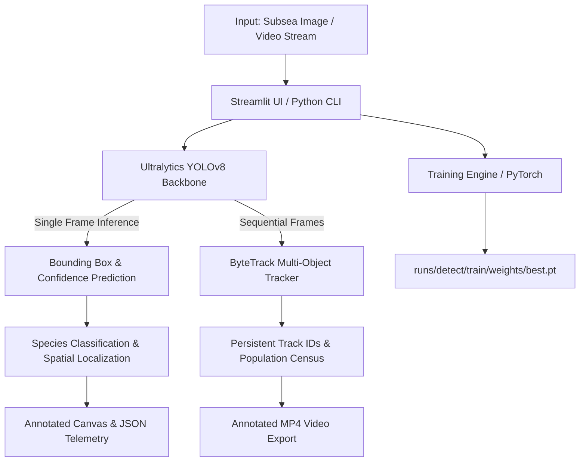

# 🐠 Underwater Vision AI — Underwater Fish Detection & Tracking with YOLOv8

[](https://www.python.org/)
[](https://github.com/ultralytics/ultralytics)
[](https://pytorch.org/)
[](https://opencv.org/)
[](https://streamlit.io/)
[](https://opensource.org/licenses/MIT)

An end-to-end Computer Vision system engineered for automated underwater marine life monitoring, fine-tuned fish species identification, and persistent multi-object tracking. Featuring a customized YOLOv8 model and an interactive Streamlit engineering console, this application addresses key vision challenges in aquatic environments and provides a foundation for Autonomous Underwater Vehicles (AUVs) and Remotely Operated Vehicles (ROVs).

---

## 📑 Table of Contents

- [Project Overview](#-project-overview)
- [Key Features](#-key-features)
- [Target Marine Species](#-target-marine-species)
- [Architecture & Tech Stack](#-architecture--tech-stack)
- [Project Structure](#-project-structure)
- [Hardware & Environment Requirements](#-hardware--environment-requirements)
- [Installation Guide (Windows PowerShell)](#-installation-guide-windows-powershell)
- [Execution & Usage](#-execution--usage)
  - [1. Launching the Streamlit Web Application](#1-launching-the-streamlit-web-application)
  - [2. Image Detection & Export](#2-image-detection--export)
  - [3. Video Detection & ByteTrack Fish Tracking](#3-video-detection--bytetrack-fish-tracking)
  - [4. Model Training Pipeline](#4-model-training-pipeline)
  - [5. Standalone CLI & Utility Scripts](#5-standalone-cli--utility-scripts)
- [Evaluation & Benchmark Results](#-evaluation--benchmark-results)
- [Example Screenshots](#-example-screenshots)
- [Underwater Robotics (ROV / AUV) Roadmap](#-underwater-robotics-rov--auv-roadmap)
- [Limitations & Failure Modes](#-limitations--failure-modes)
- [License & Acknowledgments](#-license--acknowledgments)

---

## 🌊 Project Overview

Monitoring marine ecosystems and fish populations typically requires human divers or manual review of thousands of hours of submerged video footage. Automated underwater vision faces acute physical domain challenges:

1. **Wavelength-dependent light attenuation** (rapid absorption of red spectrum, resulting in heavy green/blue color cast).
2. **Turbidity and forward/backward scattering** (suspended organic particles and marine snow reducing edge contrast).
3. **Dynamic lighting caustics and occlusion** (refraction patterns from surface waves and background reef clutter).

**Underwater Vision AI** addresses these challenges by combining:
- A compact **YOLOv8** object detector trained directly on submerged in-situ imagery across 5 distinct fish taxa.
- Multi-object tracking powered by **ByteTrack** for temporal association, track ID persistence, and accurate population counting in continuous video streams.
- A full-featured **Streamlit analytical interface** featuring visual telemetry, custom inference parameter tuning, dynamic dataset training, validation curve plotting, and video export capabilities.

---

## ⚡ Key Features

| Capability | Module | Description |
|---|---|---|
| 🔍 **Still Image Detection** | `page_image.py` | Detects fish in uploaded images (`.jpg`, `.png`, `.webp`, `.bmp`). Displays annotated bounding boxes, color-coded class labels, confidence scores, inference latency (ms), and per-species counters. Exports annotated image (PNG) and structured detections (JSON). |
| 🎬 **Video Detection & Tracking** | `page_video.py` | Performs frame-by-frame inference on underwater video files (`.mp4`, `.avi`, `.mov`, `.mkv`). Employs **ByteTrack** (`bytetrack.yaml`) to assign unique tracking IDs, track fish trajectories across frames, and output an annotated MP4 video with real-time FPS overlay. |
| 🔢 **Distinct Fish Counting** | `detector.py` | Eliminates duplicate counts in video feeds by associating bounding boxes with persistent track IDs, ensuring reliable census calculations rather than raw per-frame box summations. |
| 🏋️ **In-App & CLI Model Training** | `page_train.py` / `train.py` | Train YOLOv8 backbones (`yolov8n` through `yolov8x`) using either the bundled dataset or custom uploaded ZIP datasets with automatic YAML schema validation. Exposes hyperparameter control (epochs, batch size, learning rate, image size). |
| 📊 **Quantitative Model Evaluation** | `page_eval.py` | Live visualization of model metrics parsed directly from `results.csv`: Precision, Recall, mAP@50, mAP@50-95, interactive Plotly loss curves, latency benchmarking, and visual inspection of confusion matrices and validation prediction batches. |
| 🌊 **System Telemetry Dashboard** | `page_dashboard.py` | Central operational control center displaying hardware acceleration status (CPU / CUDA GPU), active model weight paths, class definitions, persistent analysis history (`history.json`), and ROV deployment readiness. |

---

## 🐟 Target Marine Species

The current production weights (`runs/detect/train/weights/best.pt`) are fine-tuned across **5 marine fish species**:

| Class ID | Species Name | Common Name / Ecological Niche | Interface Color Code |
|:---:|---|---|:---:|
| `0` | *Acanthopagrus Palmaris* | North West Black Bream (Indo-Pacific sparid) | `#FF6B6B` Coral Red |
| `1` | *Caranx* | Trevally / Jack (Fast pelagic predator) | `#4ECDC4` Turquoise |
| `2` | *Chaetodon Vagabundus* | Vagabond Butterflyfish (Coral reef specialist) | `#FFE66D` Golden Yellow |
| `3` | *Epinephelus* | Grouper (Benthic reef dweller) | `#6B5B95` Deep Violet |
| `4` | *Gerres* | Mojarra / Silver Biddy (Shallow coastal swimmer) | `#45B7D1` Ocean Blue |

---

## 🛠 Architecture & Tech Stack



- **Inference & Deep Learning**: PyTorch (`torch`, `torchvision`), Ultralytics YOLOv8
- **Computer Vision & Video I/O**: OpenCV (`opencv-python` headless patched via `cv2_patch.py`), Pillow (`PIL`)
- **Tracking Algorithm**: ByteTrack (`bytetrack.yaml` integrated through Ultralytics tracking API)
- **Web Interface & Visualization**: Streamlit, Plotly, Pandas, NumPy
- **System Utilities**: Psutil, PyYAML

---

## 📁 Project Structure

```
Underwater-Fish-Detection-YOLOv8-main/
├── app/
│   ├── __init__.py
│   ├── config.py             # Central application configuration & paths
│   ├── cv2_patch.py          # Headless OpenCV compatibility patch for Streamlit
│   ├── detector.py           # Core detection, ByteTrack tracking, and video overlay routines
│   ├── metrics.py            # Results parser, metrics extractor, and inference benchmark
│   ├── style.css             # Custom Dark Ocean design system
│   ├── trainer.py            # Training session manager & dataset YAML validation
│   ├── utils.py              # File I/O, device diagnostics, and image format converters
│   └── pages/
│       ├── __init__.py
│       ├── page_dashboard.py # Operational telemetry, target species, and historical runs
│       ├── page_image.py     # Image upload, bounding box inference, and JSON/PNG export
│       ├── page_video.py     # Video tracking, fish counting, and MP4 generation
│       ├── page_train.py     # Interactive training manager with custom dataset uploader
│       └── page_eval.py      # Quantitative metrics, Plotly training curves, and validation plots
│
├── dataset/
│   ├── data.yaml             # YOLOv8 dataset configuration (train/val/test splits & class names)
│   ├── README.roboflow.txt   # Dataset provenance and export details
│   ├── train/                # Training partition (images & YOLO txt labels)
│   ├── valid/                # Validation partition (images & YOLO txt labels)
│   └── test/                 # Test partition (images & YOLO txt labels)
│
├── runs/
│   └── detect/
│       └── train/            # Active training artifacts
│           ├── weights/
│           │   ├── best.pt   # Checkpoint with optimal validation mAP
│           │   └── last.pt   # Final epoch checkpoint
│           ├── results.csv   # Per-epoch training & validation metrics log
│           ├── results.png   # Composite training curves plot
│           ├── args.yaml     # Exact training hyperparameters record
│           ├── confusion_matrix.png
│           ├── BoxPR_curve.png
│           └── val_batch*.jpg
│
├── .streamlit/
│   └── config.toml           # Streamlit server & custom theme configuration
├── exports/                  # Target directory for exported annotated videos
├── uploads/                  # Temporary staging directory for user uploads
├── history.json              # Persistent analysis ledger
├── predict.py                # Direct CLI inference on test image
├── predict_any.py            # Desktop file dialog inference tool
├── train.py                  # Standalone CLI training script
├── test_detection.py         # Automated environment & model diagnostic test
├── requirements.txt          # Python package dependencies
├── yolov8n.pt                # Base pre-trained YOLOv8 nano model
├── test.jpg                  # Reference test image
├── LICENSE                   # MIT License
└── README.md                 # Project documentation
```

---

## 💻 Hardware & Environment Requirements

### Minimum Requirements
- **OS**: Windows 10/11, Ubuntu 20.04+, or macOS
- **CPU**: Dual-core x86_64 or Apple Silicon processor
- **RAM**: 8 GB minimum (16 GB recommended for video tracking)
- **Disk Space**: ~3 GB free space for environment, weights, and sample datasets

### GPU Acceleration (Optional but Recommended for Video & Training)
- **GPU**: NVIDIA GPU with CUDA Compute Capability 6.0+
- **VRAM**: 4 GB minimum (6+ GB recommended for batch training)
- **CUDA Toolkit**: CUDA 11.8 or 12.1+

---

## 🚀 Installation Guide (Windows PowerShell)

Follow these step-by-step instructions in Windows PowerShell to set up the development environment.

### Step 1: Open PowerShell and Navigate to the Repository

```powershell
cd c:\Users\User\Documents\Underwater-Fish-Detection-YOLOv8-main
```

### Step 2: Configure Execution Policy (If restricted)

If script execution is disabled on your Windows machine, allow local virtual environment scripts for the current session:

```powershell
Set-ExecutionPolicy -ExecutionPolicy RemoteSigned -Scope Process
```

### Step 3: Create and Activate Virtual Environment

```powershell
# Create virtual environment
python -m venv .venv

# Activate the environment in PowerShell
.\.venv\Scripts\Activate.ps1
```

### Step 4: Install PyTorch

Choose the command matching your hardware setup:

**Option A — CPU Only:**
```powershell
pip install torch torchvision --index-url https://download.pytorch.org/whl/cpu
```

**Option B — NVIDIA GPU with CUDA 11.8:**
```powershell
pip install torch torchvision --index-url https://download.pytorch.org/whl/cu118
```

### Step 5: Install Application Dependencies

```powershell
pip install -r requirements.txt
```

### Step 6: Verify Environment Health

Run the built-in diagnostic test suite to verify module imports, model loading, and basic detection:

```powershell
python test_detection.py
```

*Expected output: All checks marked with `✅` and confirmation that the model loaded 5 target classes successfully.*

---

## 🖥 Execution & Usage

### 1. Launching the Streamlit Web Application

Start the web application locally:

```powershell
streamlit run streamlit_app.py
```

The application will start and automatically open in your default browser at:
`http://localhost:8501`

Use the sidebar navigation to switch between modules:
- **🌊 Dashboard**: Hardware stats, class reference, and past inference logs.
- **🔍 Détection Image**: Still image analysis and bounding box extraction.
- **🎬 Détection Vidéo**: Video processing with ByteTrack tracking.
- **🏋️ Entraînement**: Retraining on current or custom datasets.
- **📊 Évaluation**: Metric breakdown and training curve visualization.

---

### 2. Image Detection & Export

1. Navigate to **🔍 Détection Image** in the sidebar.
2. Select your desired model:
   - **Trained Model (`best.pt`)**: Recommended for the 5 fish species.
   - **YOLOv8n Pretrained**: Base COCO model for general object testing.
   - **Custom Path**: Load any `.pt` weight checkpoint on your filesystem.
3. Configure the confidence slider (default `0.25`) and IoU threshold (default `0.45`).
4. Upload an image (`.jpg`, `.jpeg`, `.png`, `.webp`, `.bmp`).
5. Click **Lancer la détection**.
6. Inspect the side-by-side original and annotated canvases, detected count per species, and inference time.
7. Click **Télécharger l'image annotée** (PNG) or **Exporter les métadonnées** (JSON) to save the detection results.

---

### 3. Video Detection & ByteTrack Fish Tracking

1. Navigate to **🎬 Détection Vidéo**.
2. Adjust detection parameters:
   - **Confidence threshold**: Filter out weak detections in noisy water.
   - **IoU threshold**: Fine-tune Non-Maximum Suppression (NMS).
   - **Image size**: Select resolution (`320` to `768`, default `640`).
   - **Tracking ByteTrack**: Keep enabled to maintain continuous object IDs across frames.
3. Upload an underwater video file (`.mp4`, `.avi`, `.mov`, `.mkv`).
4. Click **Démarrer l'analyse vidéo**.
5. The pipeline processes each frame, executes ByteTrack association, draws persistent tracking tags (`#ID Class Conf`), and counts distinct individuals.
6. Once complete, view the processed video preview, average FPS, total unique fish observed, and download the annotated `.mp4` file from the `exports/` folder.

---

### 4. Model Training Pipeline

You can train a model using either the web interface or the command line.

#### Via Streamlit Interface:
1. Navigate to **🏋️ Entraînement**.
2. In the **Dataset existant** tab:
   - Select model architecture (`yolov8n.pt`, `yolov8s.pt`, etc.).
   - Configure Epochs, Batch Size, Learning Rate, and Image Size.
   - Click **Démarrer l'entraînement**.
3. In the **Importer un dataset** tab:
   - Upload a custom `.zip` containing a YOLO-format dataset with `data.yaml`.
   - The app verifies dataset integrity (YAML presence, train/val image counts) and extracts it for training.

#### Via Command Line:
Modify `train.py` or run directly with default settings (20 epochs, YOLOv8n, batch 16):

```powershell
python train.py
```

New model weights and metrics will be saved automatically to `runs/detect/train/`.

---

### 5. Standalone CLI & Utility Scripts

#### Quick Single Image Inference:
```powershell
python predict.py
```
*Runs inference on `test.jpg` with `runs/detect/train/weights/best.pt`, displaying and saving the output to `runs/detect/predict/`.*

#### Desktop File Dialog Picker:
```powershell
python predict_any.py
```
*Opens a Windows native file picker window to select any image from disk and immediately applies fish detection.*

---

## 📈 Evaluation & Benchmark Results

The current model was trained and evaluated using the bundled dataset. Below are the verified metrics recorded in `runs/detect/train/results.csv`:

### Training Configuration
- **Base Architecture**: YOLOv8 Nano (`yolov8n.pt`)
- **Input Resolution**: 640 × 640
- **Batch Size**: 16
- **Training Epochs**: 20
- **Device**: CPU / CUDA-compatible

### Quantitative Performance Metrics (Epoch 20)

| Metric | Measured Value | Percentage |
|---|:---:|:---:|
| **Precision (B)** | `0.9839` | **98.39%** |
| **Recall (B)** | `0.9815` | **98.15%** |
| **mAP@50 (B)** | `0.9926` | **99.26%** |
| **mAP@50-95 (B)** | `0.8516` | **85.16%** |
| **Final Train Box Loss** | `0.6228` | — |
| **Final Train Class Loss** | `0.4532` | — |
| **Final Validation Box Loss** | `0.6481` | — |
| **Final Validation Class Loss** | `0.4187` | — |

> [!NOTE]
> Detailed training history, confusion matrices, and precision-recall curves are available in the `runs/detect/train/` folder and can be explored interactively via the **Évaluation** tab in the web application.

---

## 🖼 Example Screenshots

> [!TIP]
> Place repository UI captures in the `assets/screenshots/` directory using the paths referenced below.

### 1. Operational Telemetry Dashboard
```markdown

```
*System status indicators, GPU/CPU telemetry, target species palette, and historical detection logs.*

### 2. Still Image Detection & Bounding Boxes
```markdown

```
*Multi-class fish identification with confidence annotations and per-class summary statistics.*

### 3. ByteTrack Video Multi-Object Tracking
```markdown

```
*Persistent track IDs across consecutive video frames for accurate fish population counting.*

### 4. Interactive Evaluation & Training Analytics
```markdown

```
*Dynamic Plotly curves for bounding box loss, classification loss, precision, recall, and mAP.*

---

## 🤖 Underwater Robotics (ROV / AUV) Roadmap

This repository includes configuration hooks for subsea robotics deployment (see `ROV_STREAM_ENABLED`, `ROV_API_HOST`, `ROV_API_PORT` in `app/config.py`). Future development priorities for autonomous submersibles include:

1. **Edge Hardware Acceleration**:
   - Export trained weights to **ONNX Runtime** and **TensorRT** engines for sub-15ms inference on NVIDIA Jetson Orin Nano / Orin NX embedded platforms.
   - Quantization to INT8 precision for energy-constrained battery payloads on micro-AUVs.
2. **Real-Time Video Ingestion**:
   - Direct integration of RTSP / GStreamer video pipelines from subsea cameras (e.g., Blue Robotics Low-Light HD USB cameras).
3. **Underwater Pre-Processing Pipelines**:
   - Implementation of real-time contrast enhancement algorithms (e.g., CLAHE, Dark Channel Prior, or UDCP) to mitigate turbidity and color distortion before feeding frames to YOLOv8.
4. **Bio-Mass & Size Estimation**:
   - Stereo-vision camera integration to estimate Euclidean distance, fish physical length, and biomass metrics.

---

## ⚠️ Limitations & Failure Modes

- **Optical Clutter & Extreme Depth**: In deep water (>30m) without auxiliary strobe lighting, severe red-spectrum loss degrades detection accuracy for species characterized by subtle warm coloration.
- **Dense Schooling Occlusion**: While ByteTrack reliably tracks distinct individuals, high-density overlapping schools of juvenile fish can lead to track fragmentation or ID switching.
- **Geographic Specificity**: The model is trained on five specific tropical reef species; encountering unrepresented marine organisms may produce false-positive classifications if the confidence threshold is set too low (<0.20).

---

## 📄 License & Acknowledgments

- **Application Code**: Licensed under the [MIT License](LICENSE) © 2026 Harini.
- **Object Detection Framework**: [Ultralytics YOLOv8](https://github.com/ultralytics/ultralytics) (AGPL-3.0 License).
- **Dataset**: [UnderWater Fish Detection Dataset](https://universe.roboflow.com/harini-h1ypw/underwater-fish-detection-izi1l-pu1m6/dataset/1) by Harini via Roboflow Universe (Licensed under [CC BY 4.0](https://creativecommons.org/licenses/by/4.0/)).
- **Tracking Algorithm**: [ByteTrack: Multi-Object Tracking by Associating Every Detection Box](https://github.com/ifzhang/ByteTrack) (Zhang et al.).
